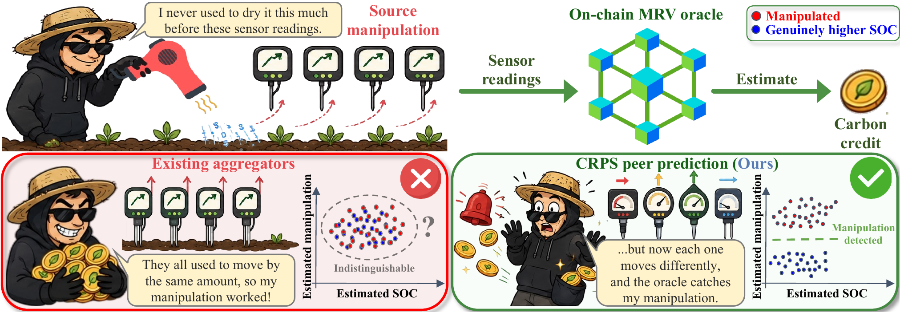
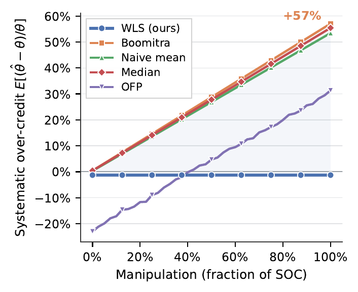
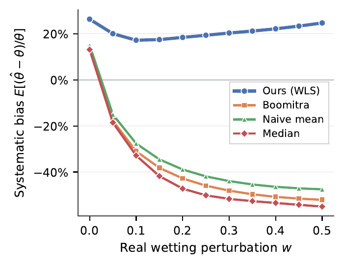
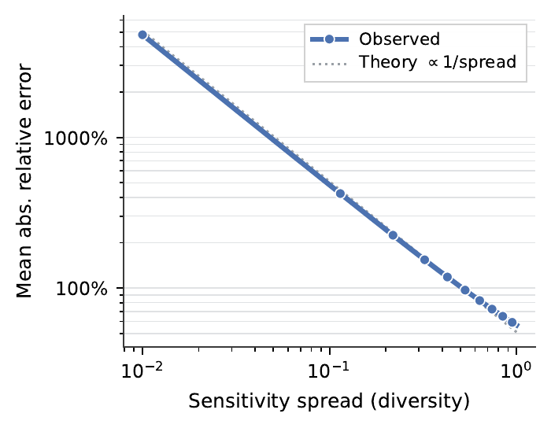

<div align="center">

# Manipulation-Resistant Oracles via Continuous Peer Prediction

Junhao Song, Tanis Rolandi, Adam Novocky, Enrico Biffis, William Knottenbelt

Imperial College London · Hitachi Europe

**MARBLE 2026** · Limassol, Cyprus

[](https://arxiv.org/abs/2610.35888)
[](https://junhaosong.com/crps-wls/)
[](https://youtu.be/HT-BhesK4_s)
[](LICENSE)

</div>

<p align="center">
  
</p>

A carbon project operator can dry a site before measurement and be paid for soil
organic carbon (SOC) that was never stored. In our mechanism, sensors report
Gaussian beliefs and are paid with the continuous ranked probability score (CRPS)
against their peers, which makes truthful reporting a strict equilibrium. A
weighted least squares (WLS) read-out then splits the reports into the true value
and the manipulation. The main result: manipulation can be identified and deterred
from the reports alone if and only if the sensors respond to it by different
amounts.

## Results

<table>
  <tr>
    <td width="33%"></td>
    <td width="33%"></td>
    <td width="33%"></td>
  </tr>
  <tr>
    <td><b>Over-credit.</b> Shift-naive aggregators credit up to 57% more carbon than is there. The WLS estimate stays near zero. (Fig. 5a)</td>
    <td><b>Real spectra.</b> As real spectra are wetted, the aggregators collapse. WLS stays within the models' own calibration bias. (Fig. 2a)</td>
    <td><b>Diversity is necessary.</b> As the sensor sensitivities converge, the error diverges, as the theorem predicts. (Fig. 2b)</td>
  </tr>
</table>

## Quick start

```bash
git clone https://github.com/Rqcker/crps-wls && cd crps-wls
pip install -r requirements.txt   # Python 3.10+
python -m src.plots               # every figure from the committed results, into figures/
```

No dataset or GPU is needed for the figures.

## Reproducing the experiments

The experiments draw soil carbon values from the LUCAS 2018 topsoil survey, whose
licence does not allow redistribution. Request the data and place the CSV as
described in [`data/README.md`](data/README.md), then run:

```bash
python -m src.experiments         # all 16 experiments, about 15 minutes on a laptop CPU
python -m src.plots
```

The committed results in `src/data/` come from this version of the code.
`exp1`–`exp11` are in `src/experiments.py`; the other experiments are modules in `src/`.

| Paper | Code | Output |
|---|---|---|
| Fig. 2(a) | `src/real_manipulation.py` (GPU) | fig13 |
| Fig. 2(b) | `exp3` | fig4 |
| Fig. 3(a), 3(b) | `exp6`, `exp5` | fig7, fig6 |
| Fig. 4(a), 4(b) | `exp4`, `exp_collusion` | fig5, fig14 |
| Fig. 5(a), 5(b) | `exp4`, `exp2` | fig12, fig3 |
| Table 2 | `src/spectral_models.py` (GPU) | `ossl_data/measured_params_cluster.json` |
| Table 3 | `exp4`, `exp8` | `src/data/exp4_data.csv`, `exp8_data.csv` |
| Table 4 | `src/stake_worked_example.py` | printed |
| Table 5 | `exp_regression_baseline` | `src/data/exp_regression_baseline_data.csv` |

The other figures are supplementary sweeps; the noise and calibration sweeps are
also on the [project page](https://junhaosong.com/crps-wls/#robustness). The GPU
stage that measures the sensor parameters is described in
[`cluster/README.md`](cluster/README.md).

## Repository

```
src/          mechanism, experiments and figures
src/data/     committed experiment results
ossl_data/    measured sensor parameters
data/         place the LUCAS 2018 CSV here
cluster/      Slurm scripts for the GPU stage
```

## Citation

```bibtex
@inproceedings{song2026manipulation,
  author        = {Song, Junhao and Rolandi, Tanis and Novocky, Adam and
                   Biffis, Enrico and Knottenbelt, William},
  title         = {Manipulation-Resistant Oracles via Continuous Peer
                   Prediction},
  booktitle     = {Mathematical Research for Blockchain Economy (MARBLE 2026)},
  publisher     = {Springer},
  year          = {2026},
  eprint        = {2610.35888},
  archivePrefix = {arXiv},
  primaryClass  = {stat.AP}
}
```

## Licence

MIT. See [LICENSE](LICENSE).
